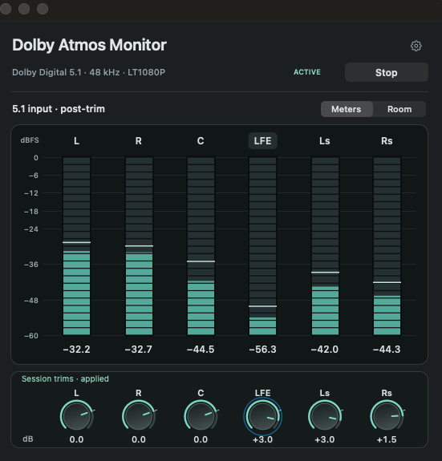
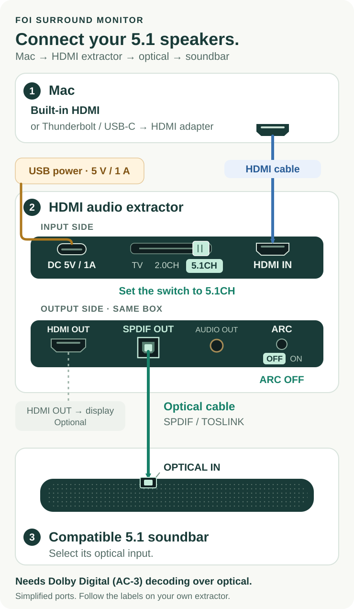
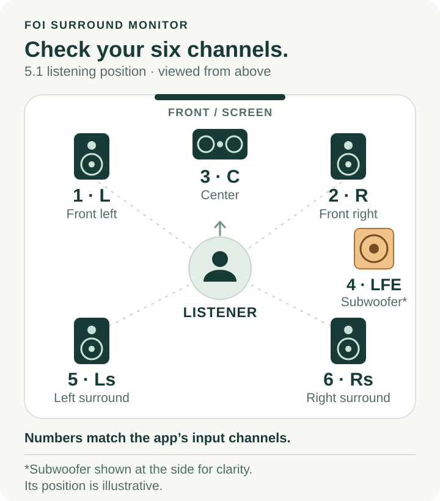

# FOI Surround Monitor

Hear a live 5.1 mix on the soundbar you already own. The app takes six channels from your Mac, lets you meter and trim each one, and sends **Dolby Digital 5.1 (AC-3), 48 kHz, 448 kb/s** to a compatible HDMI output. Our studio setup uses a Mac mini M4, an HDMI audio extractor and a Sony HT-S20R connected by optical cable.

Created by [Sourish Mukherjee (@msourish)](https://github.com/msourish) with SOURX, the FOI Studios AI collaborator.

**First time?** [Connect the cables](#1-connect-the-cables) → [Install the app](#2-build-and-install) → [Set up Audio MIDI](#3-set-up-audio-midi) → [Start monitoring](#4-start-the-monitor) → [Check your speakers](#5-check-your-speakers). You can also [use an AI assistant](#install-with-an-ai-assistant).



*Sourish’s studio build during playback. The public app is named **FOI Surround Monitor**. Each knob adjusts the matching meter and speaker.*

## 1. Connect the cables



1. **Mac → HDMI IN.** If your Mac has HDMI, run an HDMI cable straight from the Mac to **HDMI IN** on the extractor. With a USB-C or Thunderbolt port, use a **USB-C-to-HDMI cable or adapter with HDMI audio support**. The USB-C socket marked **DC 5V/1A** on the pictured extractor is for power only.
2. **Power and set the extractor.** Connect its specified 5 V supply. Slide the **TV / 2.0CH / 5.1CH** selector to **5.1CH**. Set the extractor’s **ARC OFF/ON** button to **OFF** so it takes audio from the Mac’s HDMI input. If your setup needs a display for the HDMI connection, connect **HDMI OUT** to a display’s HDMI input. Your Mac can keep its usual main display.
3. **Extractor → soundbar.** Remove any protective caps from the optical cable. Connect **SPDIF OUT** on the extractor to **OPTICAL IN**, **DIGITAL IN (OPTICAL)** or **TV IN (OPTICAL)** on your soundbar or receiver. Use a system that can decode **Dolby Digital 5.1 over optical**. The round 3.5 mm jack carries stereo.
4. **Choose the soundbar input and turn the volume low.** On the **Sony HT-S20R**, press **INPUT** until **TV** appears. On its remote, use **MENU → HDMI → TV AUDIO → OPTICAL**, then **MENU → SPEAKER → MULTI SPEAKER → OFF**. This makes the speaker test easier to interpret. Other models may label the input **Optical** or **D.IN**. [Sony operating instructions](https://www.sony.com/electronics/support/res/manuals/5010/86e668486c91d9f31ddef04cdbb4258e/50107271M.pdf)

**Finding the extractor in India.** The Microware product photos match the rounded case, port layout and “4K HDR Converter” marking on our unit. The unit carries no visible model number. The manufacturer lists the matching design under item **SON-5214569**. The Amazon India listing is a different Microware model, **MMPL-HDMI2.0b**, with different port positions. We have not tested that model. Compare the ports and look for a 5.1 selector and Dolby Digital passthrough over optical. Compatibility also depends on which encoded formats the complete HDMI connection advertises to macOS. [Photo-matched Microware extractor](https://microware.in/product/microware-4k-hdr-hdmi-to-hdmi-arc-audio-extractor-5-1ch-spdif-3-5mm-stereo-audio-converter/) · [Alternative on Amazon India (MMPL-HDMI2.0b)](https://www.amazon.in/Microware-Extractor-Optical-Embedder-Converter/dp/B0B4G7ZSK4)

<a id="build-and-install"></a>

## 2. Build and install

The beta ships as source for **Apple silicon (M-series) Macs running macOS 13 or later**. Check **Apple menu → About This Mac**. These steps build the app on your own Mac.

1. Open **Terminal**. If Apple’s Command Line Tools are missing, run `xcode-select --install` and finish the installer before continuing. [Apple’s installation guide](https://developer.apple.com/documentation/xcode/installing-the-command-line-tools/)
2. Install **BlackHole 16ch** (the virtual audio cable) and **FFmpeg** (the encoder). If you use Homebrew, run the following commands one at a time. Complete any installer prompt and restart the Mac after installing BlackHole. You can also obtain the dependencies from their publishers. [Homebrew](https://brew.sh/) · [BlackHole 16ch](https://existential.audio/blackhole/) · [FFmpeg](https://ffmpeg.org/download.html)

   ```sh
   brew install --cask blackhole-16ch
   brew install ffmpeg
   ```

3. Download and unzip the [source beta ZIP](https://github.com/msourish/FOI-Surround-Monitor/archive/refs/tags/v0.1.0-beta.1.zip). In Terminal, type `cd` followed by a space, drag the **unzipped folder** from Finder into Terminal, and press Return. Then run:

   ```sh
   zsh build.sh && zsh install.sh
   ```

4. In Finder, press **Shift–Command–G**, enter `~/Applications` and open **FOI Surround Monitor**. The installer leaves an existing copy in place. For a custom FFmpeg location, use `zsh build.sh --ffmpeg /absolute/path/to/ffmpeg`, then `zsh install.sh`. Keep FFmpeg and its libraries installed.

### Install with an AI assistant

<details>
<summary>Show the copyable installation prompt</summary>

Copy this into ChatGPT or another assistant. A chat-only assistant can walk you through the same steps while you operate your Mac.

```text
Help me install FOI Surround Monitor by Sourish Mukherjee (@msourish) on my Mac.
Use the official repository https://github.com/msourish/FOI-Surround-Monitor and the tagged v0.1.0-beta.1 source release. Read the current README for setup.
First check my Mac chip, macOS version, HDMI or USB-C-to-HDMI connection, and whether my soundbar decodes Dolby Digital 5.1 through optical. Check which prerequisites I already have.
Explain any installation or restart before proceeding. Let me handle administrator prompts and macOS permissions. Preserve existing apps, projects and output settings.
Help me install the missing prerequisites, build locally with zsh build.sh, and run zsh install.sh. Guide me through BlackHole 16ch at 48 kHz in Audio MIDI Setup, then help me choose Fairlight 5.1 or Apple Music 7.1.4 input as appropriate.
Ask before playing a low-volume speaker test. Tell me what I should see on the meters and hear from each speaker, and how to stop and restore my normal output. If you cannot control my Mac, give me one step at a time.
```

</details>

## 3. Set up Audio MIDI

1. Press **Command–Space**, type **Audio MIDI Setup**, and open it. In the menu bar choose **Window → Show Audio Devices**. Select **BlackHole 16ch** in the left column.
2. Select its **Output** pane if tabs are shown. Set **Format** to **48,000 Hz** and keep the **16-channel** format. BlackHole carries the audio into the monitor. You’ll choose the physical HDMI output inside FOI Surround Monitor in step 4.
3. Click **Configure Speakers…** and choose the layout for the source you’re about to use. If **Multichannel** is a separate tab on your macOS version, select it. Select each speaker on the diagram and use its channel menu to check the assignments below. Click **Apply** (or **Done**, depending on macOS). [Apple’s speaker configuration guide](https://support.apple.com/guide/audio-midi-setup/set-up-external-speakers-ams1005/mac)

| Source | Speaker configuration on BlackHole | Output to select for playback |
|---|---|---|
| **DaVinci Resolve / Fairlight** | **5.1 Surround**. Assign **1 L · 2 R · 3 C · 4 LFE · 5 Ls · 6 Rs**. | Choose **BlackHole 16ch** inside Resolve. Your normal macOS output can stay selected. |
| **Apple Music Atmos experiment** | **7.1.4** (may be labeled **Dolby Atmos 7.1.4**). In our setup, 1–6 are the same assignments as above, 7–8 rear left/right, 9–10 top-front left/right, 11–12 top-rear left/right. | Note your normal output. In **System Settings → Sound → Output**, choose **BlackHole 16ch**. In **Music → Settings → Playback → Dolby Atmos**, select **Automatic**. [Dolby’s studio setup](https://professionalsupport.dolby.com/s/article/How-to-Monitor-Apple-Music-in-7-1-4-in-a-Studio?language=en_US) |

When BlackHole is the system output, Music can be silent until the monitor starts. Leave the macOS **input** device as it was.

## 4. Start the monitor

1. In **FOI Surround Monitor**, choose **Request input access…** if prompted. macOS calls this **Microphone** permission because the app reads BlackHole’s virtual input. If permission was denied, review **System Settings → Privacy & Security → Microphone**.
2. Open **⚙ → Output** and choose the HDMI device feeding the extractor. Ours appears as **LT1080P**. Yours can have another name. Click **Start** and leave all six trims at **0 dB** for the first check. The status line shows the encoder format and output device. The receiver’s own display confirms what arrived.
3. **Fairlight users:** in **Resolve → Preferences → System → Video and Audio I/O**, select **BlackHole 16ch** as Output device. Set the project to **48 kHz**. In **Fairlight → Bus Format**, set Bus 1 to **5.1**. Route your tracks to that bus. In **Fairlight → Patch Input/Output**, choose **Bus Out → Audio Outputs** and patch Bus 1 to BlackHole **1–6** in the table’s order. Play the timeline. The receiver follows your mix faders, mutes and pans. Bus Out bypasses Resolve’s monitor volume, so use the receiver for listening level.

   If outputs 1–2 already have a **Control Room** or direct-track patch, remove that competing patch in your monitoring project before assigning Bus Out. Recheck the mapping whenever you switch Resolve output devices. If the mix is six separate mono files, assign the six tracks in the order above and use **Fairlight → Link Group → 5.1** before routing to Bus 1.

## 5. Check your speakers



**Start with one speaker.** With the monitor running at low volume, select **BlackHole 16ch → Configure Speakers…** in Audio MIDI Setup and click **Left Front** to play Apple’s test sound. The **L** meter should move and the front-left speaker should play. Repeat for right, center, LFE and the two surrounds in the **5.1** layout. You can also solo a known six-channel identification cue in Fairlight. On the Sony, open **MENU → CURRENT STATUS**, press **ENTER**, and scroll to **Stream Information**. Look for **DOLBY DIGITAL** and listen for each cue in its own speaker.

**Try it with Apple Music.** After selecting the **7.1.4** setup in step 3, open the album below in the **Music app on the Mac** and play the Atmos version with an Apple Music subscription. Start with **Left front channel**, then **Right front channel** and **Center front channel**. Watch the corresponding meter and listen from your seat. Try the LFE and surround tracks separately. The individual tracks make a swapped channel much easier to hear than a full song. [Play the 2L Immersive Channel Identification 7.1.4 album on Apple Music India](https://music.apple.com/in/album/2l-immersive-channel-identification-7-1-4/1693419553) · [Start with Left front channel](https://music.apple.com/in/album/2l-immersive-channel-identification-7-1-4/1693419553?i=1693419896)

**What Sourish heard.** With Apple Music configured for 7.1.4, Sourish describes feeling the music all around him on the Sony 5.1 system. In the studio test, BlackHole showed signal on twelve input channels. This app reads **channels 1–6** and sends those six as Dolby Digital over optical. A rear- or height-only cue assigned to channels 7–12 can be silent on this path. The six-speaker test above verifies the channels this app sends to your soundbar.

## If something sounds wrong

| What you notice | What to check first |
|---|---|
| HDMI device missing from the app | Check extractor power, HDMI **IN**, and **5.1CH**. Try **⚙ → Output → Refresh outputs**. If needed, connect a display to HDMI OUT. The complete chain must advertise a single HDMI output stream with 48 kHz AC-3 support to Core Audio. |
| Six meters stay silent | Check the source is playing into **BlackHole 16ch**, that input access is allowed, and that BlackHole is at 48 kHz. For Fairlight, recheck the **Bus Out** patch. |
| Meters move but soundbar shows **LPCM** or stays silent | Select the optical input, check **SPDIF OUT → OPTICAL IN**, set extractor ARC **OFF** and select **5.1CH**. Stop any other player using encoded HDMI, then stop and restart the monitor. |
| The front-left test also plays behind you | Turn off the soundbar’s speaker-duplication mode. On the HT-S20R use **MULTI SPEAKER → OFF**. Repeat with a single channel. |
| A meter shows a red clip indicator | Reduce that channel’s trim. The Meters and Room views show the same post-trim peaks. Double-click a knob to return it to 0 dB. |

**When finished,** pause the source, click **Stop**, and wait for HDMI restoration. If you changed the macOS output for Music or the output device in Resolve, reselect the device you normally use there. Closing the app also requests HDMI cleanup. Session diagnostics are under **⚙ → Show session logs…**.
